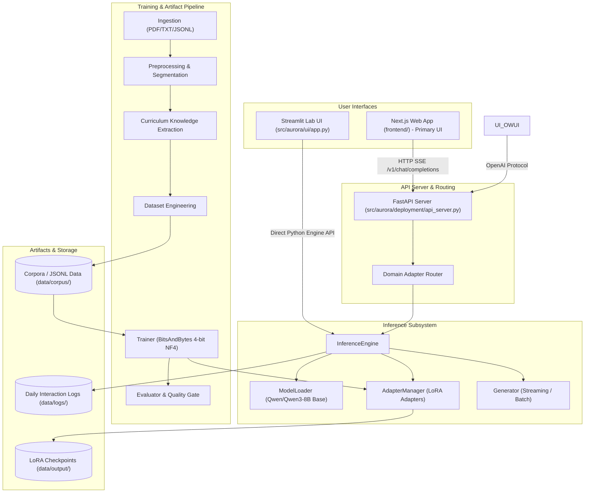
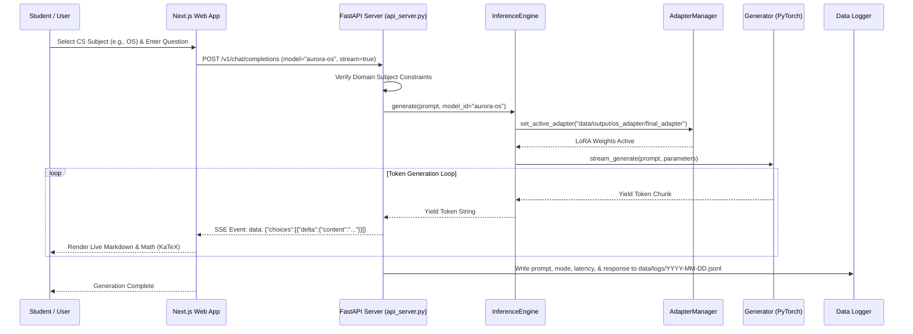
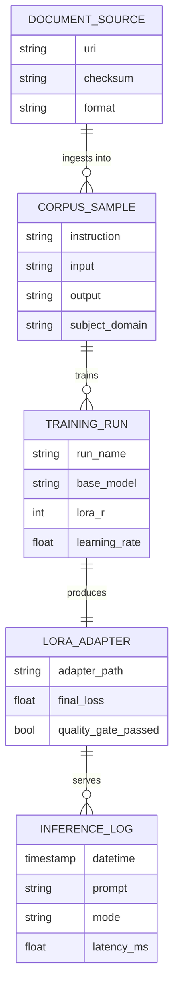
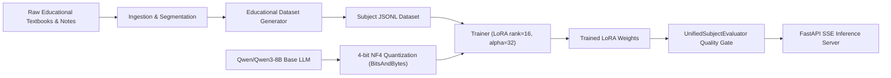
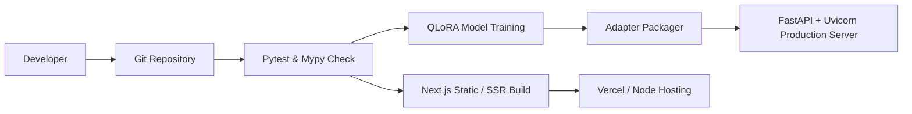

# AuroraEngine — Architectural Handover Documentation

> **Target Audience:** Engineering Leads, Senior Architects, and Incoming Developers  
> **Repository:** `AuroraEngine`  
> **Framework Type:** Research-Grade Educational AI & Domain-Specific LLM Engineering Framework  
> **Document Version:** 1.0.0  
> **Last Verified:** September 2026  

---

## 1. Project Overview

### Project Name & Purpose
**AuroraEngine** is a research-grade, modular educational AI framework designed to transform trusted educational resources (textbooks, course syllabi, lecture materials) into highly reliable, domain-specific language models. Unlike basic chat wrappers or naive Retrieval-Augmented Generation (RAG) apps, AuroraEngine builds specialized LoRA (Low-Rank Adaptation) adapter models tailored to specific Computer Science subject domains through a clean, multi-stage pipeline:

1. **Document Ingestion**: Multi-format parsing and source registry metadata tracking.
2. **Preprocessing**: Document cleaning, structure extraction, and reading order normalization.
3. **Segmentation & Structuring**: Breaking documents into semantically linked chunks and units.
4. **Knowledge & Curriculum Extraction**: Graph-based curriculum understanding and concept dependency modeling.
5. **Educational Dataset Engineering**: Synthetic QA and instruction tuning pair generation.
6. **LoRA/QLoRA Fine-Tuning**: Quantized low-rank adaptation fine-tuning on base foundation models (e.g., `Qwen/Qwen3-8B`).
7. **Unified Evaluation**: Quality gates assessing loss thresholds and domain subject accuracy.
8. **Deployment**: High-throughput FastAPI inference server streaming OpenAI SSE compliant endpoints.

### Domain Coverage
AuroraEngine currently specializes in 6 core Computer Science subject curricula:
- **DBMS**: Database Management Systems
- **DSA**: Data Structures & Algorithms
- **OOPS**: Object-Oriented Programming Systems
- **OS**: Operating Systems
- **CNT**: Computer Networks
- **OOSE**: Software Engineering & System Design

### Target Users
- **Educational Institutions & Universities**: Deploying domain-calibrated AI tutors with zero hallucination outside approved syllabi.
- **AI Researchers & Educators**: Constructing custom curriculum dependency graphs and dataset pipelines.
- **Students & Self- Learners**: Interacting with specialized subject tutors via sleek web and lab interfaces.

### Current Project Status
- **Core Pipeline Framework (`src/aurora`)**: ✅ Operational clean architecture core with strict Pydantic schemas, dependency injection, and modular pipelines.
- **Training Subsystem**: ✅ Complete QLoRA fine-tuning pipelines for all 6 individual CS subjects plus a combined Unified multi-subject adapter.
- **Inference & API Server**: ✅ Functional FastAPI server (`src/aurora/deployment/api_server.py`) serving OpenAI-compatible chat endpoints (`/v1/chat/completions`, `/v1/models`).
- **User Interfaces**:
  - **Next.js Web Frontend (`frontend/`)**: ✅ Primary and sole supported student web interface with LaTeX rendering, subject routing, and SSE streaming.
  - **Evaluation Lab UI (`src/aurora/ui/app.py`)**: ✅ Streamlit dark-mode lab interface for model evaluation and interactive testing.

---

## 2. System at a Glance

The following Mermaid diagram illustrates the high-level system components and data flows discovered in the repository:



---

## 3. Technology Stack

| Layer | Technology | Purpose | Where Used |
| ----- | ---------- | ------- | ---------- |
| **Frontend Core** | Next.js 16 (React 19, TypeScript 5) | Primary and sole supported user-facing web chat application | `frontend/` |
| **Frontend Styling** | Tailwind CSS 4, Lucide Icons | Premium UI with responsive layout | `frontend/src/` |
| **Frontend Math/Markdown** | KaTeX, react-markdown, remark-math | Rendering mathematical equations & code blocks | `frontend/src/` |
| **Lab Interface** | Streamlit | Evaluation lab interface for interactive model probing | `src/aurora/ui/app.py` |
| **Backend API Framework** | FastAPI, Uvicorn, Starlette | High-performance OpenAI-compatible REST/SSE server | `src/aurora/deployment/api_server.py` |
| **Core Architecture** | Python 3.10+, Pydantic v2 | Type safety, clean architecture, domain validation | `src/aurora/` |
| **AI Base Model** | `Qwen/Qwen3-8B` / `Qwen3-8B-Instruct` | Primary foundation LLM | Configs & Scripts (`run_config.json`, `train_*.py`) |
| **AI Quantization & Fine-Tuning** | PyTorch, Hugging Face `transformers`, `peft`, `bitsandbytes` (4-bit NF4) | QLoRA fine-tuning & memory-efficient inference | `src/aurora/training/`, `src/aurora/inference/` |
| **Evaluation Framework** | Custom `UnifiedSubjectEvaluator` & Quality Gates | Loss threshold checking & syllabus domain accuracy validation | `src/aurora/evaluation/`, `eval_unified.py` |
| **Data Storage / Corpora** | JSONL, Plaintext, Local Filesystem | Dataset storage, LoRA adapter weights, execution logs | `data/corpus/`, `data/output/`, `data/logs/` |
| **Testing & Quality** | Pytest 8+, Ruff, Mypy | Test runner, linter, static type enforcement | `tests/`, `pyproject.toml` |

---

## 4. Repository / Folder Structure

```text
AuroraEngine/
├── .agents/                    # Agent constitution and repository rules
├── data/                       # Local data storage directory
│   ├── corpus/                 # Processed training JSONL datasets for each CS subject
│   ├── logs/                   # Daily execution interaction logs
│   ├── output/                 # Fine-tuned LoRA adapter output directories
│   └── raw/                    # Raw input documents (PDFs, text files)
├── docs/                       # Architecture diagrams, validation reports, ADRs
│   ├── architecture/           # System architecture blueprints & ADRs
│   └── contracts/              # Specification contracts
├── frontend/                   # Next.js 16 web application
│   ├── src/
│   │   ├── app/                # Next.js App Router pages and globals.css
│   │   ├── components/         # Chat, sidebar, and layout React components
│   │   ├── config/             # API endpoints and domain subject metadata
│   │   ├── services/           # Fetch API streaming service & local storage
│   │   └── types/              # TypeScript interface definitions
│   ├── package.json            # Node.js dependencies
│   └── next.config.ts          # Next.js configuration
├── src/                        # Core Python engine source package
│   └── aurora/
│       ├── config/             # Centralized settings and path configurations
│       ├── contracts/          # Structural data validation contracts
│       ├── core/               # Exception classes, immutable artifacts, metrics
│       ├── corpus/             # Dataset builder, knowledge extractor, exporter
│       ├── dataset/            # Dataset generation interfaces & logic
│       ├── deployment/         # FastAPI REST/SSE server (api_server.py)
│       ├── evaluation/         # Multi-subject unified evaluation benchmarks
│       ├── extraction/         # Content detectors, inspectors, registry
│       ├── inference/          # Model loader, adapter manager, inference engine
│       ├── ingestion/          # PDF and file scanners, source registry
│       ├── interfaces/         # Abstract Python contracts for all phases
│       ├── knowledge/          # Concept graphs, taxonomy, classification
│       ├── models/             # Pydantic domain models (Document, Chunk, Adapter, etc.)
│       ├── normalization/      # Text normalization pipelines
│       ├── pipeline/           # Pipeline builders and execution runners
│       ├── preprocessing/      # Extractor & reading order segmenters
│       ├── registry/           # Dynamic module registry for dependency injection
│       ├── segmentation/       # Document chunking & structural segmentation
│       ├── services/           # Internal service coordinators
│       ├── storage/            # Storage interfaces (FAISS, metadata)
│       ├── studio/             # Schema generators & exporter utilities
│       ├── training/           # QLoRA fine-tuning backend, model preparer, trainer
│       ├── ui/                 # Streamlit Evaluation Lab UI (app.py)
│       ├── understanding/      # Curriculum analysis interfaces
│       └── validators/         # Schema and state invariant checkers
├── tests/                      # Pytest mirrored test suite
├── scripts/                    # Consolidated automation and execution scripts
│   ├── training/               # Multi-subject QLoRA fine-tuning scripts
│   │   ├── train_cnt.py
│   │   ├── train_dsa.py
│   │   ├── train_oops.py
│   │   ├── train_oose.py
│   │   ├── train_os.py
│   │   └── train_unified.py
│   ├── data_prep/              # Dataset preparation and corpus compilation
│   │   ├── prepare_oose.py
│   │   └── prepare_unified_corpus.py
│   ├── eval/                   # Model evaluation benchmark
│   │   └── eval_unified.py
│   ├── testing/                # Rapid verification and pipeline smoke tests
│   │   └── stage1_smoke_test.py
│   └── docs/                   # Documentation presentation generator
│       └── generate_presentation.py
├── docs/                       # Framework design and architecture specifications
│   └── presentation/           # Architecture handover presentation deck
├── pyproject.toml              # Python project configuration & tool definitions
├── run_config.json             # Hyperparameter & hardware execution config
└── README.md
```

### Folder Responsibilities Table

| Path | Responsibility | Important Files |
| ---- | -------------- | --------------- |
| [`src/aurora/core/`](file:///c:/AuroraEngine/src/aurora/core) | Foundational primitives, custom exception hierarchy, immutable artifact metadata, logger setup. | `exceptions.py`, `artifact.py`, `logging.py` |
| [`src/aurora/models/`](file:///c:/AuroraEngine/src/aurora/models) | Pydantic data schemas representing domain entities (Documents, Chunks, Adapters, Training Runs). | `document.py`, `chunk.py`, `training.py`, `inference.py` |
| [`src/aurora/interfaces/`](file:///c:/AuroraEngine/src/aurora/interfaces) | Abstract Base Classes defining strict contracts for every pipeline module. | `ingestion.py`, `training.py`, `corpus.py`, `understanding.py` |
| [`src/aurora/training/`](file:///c:/AuroraEngine/src/aurora/training) | QLoRA training engine, dataset loading, model quantization preparation, checkpoint management. | `trainer.py`, `model_preparer.py`, `pipeline.py`, `adapter_packager.py` |
| [`src/aurora/inference/`](file:///c:/AuroraEngine/src/aurora/inference) | Inference engine orchestration, base model loading (`Qwen3-8B`), dynamic LoRA adapter swapping. | `inference_engine.py`, `loader.py`, `adapter_manager.py`, `generator.py` |
| [`src/aurora/deployment/`](file:///c:/AuroraEngine/src/aurora/deployment) | FastAPI API server delivering OpenAI-compatible streaming endpoints (`/v1/chat/completions`). | `api_server.py` |
| [`src/aurora/ui/`](file:///c:/AuroraEngine/src/aurora/ui) | Streamlit dark-mode interactive lab interface. | `app.py` |
| [`frontend/`](file:///c:/AuroraEngine/frontend) | Production Next.js web application for student interaction. | `src/app/page.tsx`, `src/services/api.ts`, `src/config/api.ts` |
| [`data/corpus/`](file:///c:/AuroraEngine/data/corpus) | Standardized `.jsonl` dataset files for each Computer Science subject domain. | `unified_all_subjects_training.jsonl`, `os_training.jsonl`, `ds_training.jsonl` |
| [`data/output/`](file:///c:/AuroraEngine/data/output) | Saved LoRA adapter weights, configuration files, and evaluation reports. | `unified_adapter/`, `stage1_smoke_test/`, `unified_eval_report.json` |
| [`scripts/`](file:///c:/AuroraEngine/scripts) | Automation scripts for training, dataset preparation, evaluation, and documentation generation. | `scripts/training/`, `scripts/data_prep/`, `scripts/eval/` |

---

## 5. Application Entry Points

| Component | File | Purpose | How It Starts |
| --------- | ---- | ------- | ------------- |
| **FastAPI REST Server** | [`src/aurora/deployment/api_server.py`](file:///c:/AuroraEngine/src/aurora/deployment/api_server.py) | Provides `/v1/chat/completions` SSE streaming and `/v1/models` listing. | `python -m uvicorn aurora.deployment.api_server:app --port 8000` |
| **Next.js Web Frontend** | [`frontend/src/app/page.tsx`](file:///c:/AuroraEngine/frontend/src/app/page.tsx) | Main student interactive UI for CS subject tutoring. | `cd frontend && npm run dev` |
| **Streamlit Evaluation Lab** | [`src/aurora/ui/app.py`](file:///c:/AuroraEngine/src/aurora/ui/app.py) | Interactive UI for model testing and execution metrics visualization. | `streamlit run src/aurora/ui/app.py` |
| **Unified Training Runner** | [`scripts/training/train_unified.py`](file:///c:/AuroraEngine/scripts/training/train_unified.py) | Executes full QLoRA fine-tuning across all 6 CS subject datasets. | `python scripts/training/train_unified.py` |
| **Subject Training Scripts** | `train_os.py`, `train_dsa.py`, etc. under `scripts/training/` | Executes QLoRA fine-tuning for specific CS subjects. | `python scripts/training/train_os.py` |
| **Smoke Test Verification** | [`scripts/testing/stage1_smoke_test.py`](file:///c:/AuroraEngine/scripts/testing/stage1_smoke_test.py) | Runs rapid pipeline validation and adapter packaging checks. | `python scripts/testing/stage1_smoke_test.py` |
| **Evaluation Benchmark** | [`scripts/eval/eval_unified.py`](file:///c:/AuroraEngine/scripts/eval/eval_unified.py) | Measures model loss metrics against domain quality thresholds. | `python scripts/eval/eval_unified.py` |

---

## 6. Complete End-to-End System Flow

The diagram below maps out the request lifecycle from user interaction down to model inference and token streaming:



### Flow Breakdown
1. **User Interaction**: The user selects a domain (e.g. Operating Systems) and sends a query via Next.js or Streamlit.
2. **Request Routing**: The Next.js client posts to `/v1/chat/completions`.
3. **Domain Constraint Checking**: `AURORA_SYSTEM_PROMPT` in `api_server.py` enforces domain boundaries. Non-CS queries (e.g., cooking, general advice) are rejected with a standardized message.
4. **Adapter Resolution**: `api_server.py` maps `model_id` (e.g. `aurora-os`) to the corresponding LoRA checkpoint in `data/output/os_adapter/final_adapter`.
5. **Inference Execution**: `InferenceEngine` requests `AdapterManager` to apply adapter weights dynamically over the loaded `Qwen3-8B` base model.
6. **Streaming & Response**: `Generator` uses PyTorch generation loops to stream SSE chunks back to Next.js, which renders live markdown and KaTeX equations.
7. **Logging**: Execution statistics and prompts are saved into daily JSONL logs in `data/logs/`.

---

## 7. Frontend Architecture

AuroraEngine contains a dedicated Next.js 16 frontend located in `frontend/`.

### Component Lifecycle & Hierarchy
```text
User Action
  ↓
frontend/src/app/page.tsx (Main Layout & Chat View)
  ↓
components/Sidebar.tsx (Domain & Model Selection)
  ↓
services/api.ts (streamChatCompletion via Fetch API)
  ↓
FastAPI Backend (/v1/chat/completions SSE Stream)
  ↓
Fallback Engine (Simulate Response if Backend Offline)
```

### Key Modules in `frontend/`
- **`src/app/page.tsx`**: Main UI container containing active messages, input box, and domain context badges.
- **`src/services/api.ts`**: Handles SSE streaming over standard `fetch()`. If the backend server is unreachable, it automatically triggers an offline fallback simulation mode to keep the interface functional for UI testing.
- **`src/config/api.ts`**: Defines subject selection metadata (`DBMS`, `DSA`, `OOPS`, `OS`, `CNT`, `OOSE`) and available model adapters (`aurora-unified`, `aurora-dbms`, etc.).

---

## 8. Backend Architecture

The backend consists of two primary tiers: the REST/SSE interface layer (`src/aurora/deployment`) and the core Python domain pipeline (`src/aurora/`).

```text
HTTP Request
  ↓
FastAPI App (src/aurora/deployment/api_server.py)
  ↓
CORS Middleware & Domain Validation
  ↓
InferenceEngine (src/aurora/inference/inference_engine.py)
  ├── ModelLoader (Base Qwen3-8B Loader)
  ├── AdapterManager (LoRA PEFT Controller)
  └── Generator (Streaming Token Engine)
  ↓
PyTorch / CUDA Inference Execution
  ↓
StreamingResponse (Server-Sent Events)
```

### Clean Architecture Layers
- **Core (`src/aurora/core`)**: Zero dependencies on outer frameworks. Defines `ArtifactMetadata`, `AuroraException`, and logger primitives.
- **Models (`src/aurora/models`)**: Immutable Pydantic models (e.g. `Document`, `Chunk`, `TrainingConfig`, `GenerationResult`).
- **Interfaces (`src/aurora/interfaces`)**: Python Abstract Base Classes (`ABC`) defining exact method signatures for loaders, splitters, trainers, and evaluators.
- **Services & Pipeline (`src/aurora/pipeline`)**: Orchestration modules that combine implementations via strict interface bindings.

---

## 9. API Architecture

The FastAPI server (`src/aurora/deployment/api_server.py`) exposes standard OpenAI-compatible endpoints:

| Method | Endpoint | Purpose | Request Body | Response Format | Authentication |
| ------ | -------- | ------- | ------------ | --------------- | -------------- |
| `GET` | `/v1/models` | List available domain models and adapters | None | JSON Object (`{object: "list", data: [...]}`) | None (Public) |
| `POST` | `/v1/chat/completions` | Stream domain-specific educational completions | `{model: str, messages: array, stream: bool}` | Server-Sent Events (`data: {...}`) | None (Public) |

---

## 10. Database & Storage Architecture

AuroraEngine does not rely on traditional SQL or NoSQL database servers. Instead, it utilizes an **Artifact-Based File Storage System** optimized for ML reproducibility and clean architecture isolation:



### Storage Mechanisms
- **Corpus Data**: JSONL files stored in `data/corpus/`. Each record represents a curated instruction-response pair for fine-tuning.
- **Adapter Storage**: Binary PyTorch LoRA weight tensors (`adapter_model.safetensors`, `adapter_config.json`) saved under `data/output/<subject>_adapter/final_adapter`.
- **Interaction Logs**: Daily append-only JSONL files saved under `data/logs/YYYY-MM-DD.jsonl`.

---

## 11. AI / ML Architecture



### Model & Training Specifications
- **Base Foundation Model**: `Qwen/Qwen3-8B` / `Qwen3-8B-Instruct`
- **Quantization Method**: 4-bit NF4 (NormalFloat4) quantization via `bitsandbytes` with double quantization enabled.
- **Compute Precision**: `bfloat16` native speed configuration (optimized for Nvidia RTX GPUs, e.g. RTX 4080).
- **LoRA Configuration**:
  - `rank (r)`: 16
  - `alpha`: 32
  - `dropout`: 0.05
  - `target_modules`: `["q_proj", "k_proj", "v_proj", "o_proj", "gate_proj", "up_proj", "down_proj"]`
- **Quality Gate Threshold**: Automated evaluation pass ensuring validation loss remains below threshold prior to adapter packaging.

---

## 12. External Services and APIs

| Service | Purpose | API / SDK | Authentication | Data Flow | Fallback Behavior |
| ------- | ------- | --------- | -------------- | --------- | ----------------- |
| **Hugging Face Hub** | Base model weights download (`Qwen/Qwen3-8B`) | `huggingface_hub` / `transformers` | Optional `HF_TOKEN` | Remote download to local cache (`~/.cache/huggingface`) | Fails if model weights are not cached locally and no internet access |

---

## 13. Authentication & Authorization

> ⚠️ **Requires verification / Current State**:  
> No authentication or user authorization logic is currently implemented in `src/aurora/deployment/api_server.py` or `frontend/`. Endpoints are open to direct HTTP connections. CORS is configured to allow all origins (`allow_origins=["*"]`).

---

## 14. Configuration & Environment Variables

### Environment Variables
| Variable | Purpose | Required | Example Format |
| -------- | ------- | -------- | -------------- |
| `NEXT_PUBLIC_AURORA_API_URL` | Base URL for FastAPI backend from Next.js | No (Defaults to `http://localhost:8000/v1`) | `http://localhost:8000/v1` |
| `HF_TOKEN` | Hugging Face token for downloading gated model weights | Optional | `hf_xxxxxxxxxxxxxxxxxxxx` |
| `CUDA_VISIBLE_DEVICES` | Specifies active GPU indexes for training/inference | Optional | `0` |

### Key Configuration Files
- **[`run_config.json`](file:///c:/AuroraEngine/run_config.json)**: Hyperparameter configuration defining base model, dataset specs, quantization modes, and training hyperparameters.
- **[`pyproject.toml`](file:///c:/AuroraEngine/pyproject.toml)**: Python packaging specs, tool configs for `ruff`, `mypy`, and `pytest`.
- **[`src/aurora/config/settings.py`](file:///c:/AuroraEngine/src/aurora/config/settings.py)**: Central Pydantic settings manager for framework directories and defaults.

---

## 15. Installation & Local Development

### Prerequisites
- **Python**: Version `3.10` or higher
- **Node.js**: Version `18.0` or higher (for Next.js frontend)
- **GPU**: NVIDIA GPU with CUDA support recommended (e.g. RTX 3080/4080 with 16GB+ VRAM for local training/inference)

### Setup Instructions

1. **Clone & Setup Python Virtual Environment**:
   ```bash
   git clone <repository-url>
   cd AuroraEngine
   python -m venv .venv
   # Windows:
   .venv\Scripts\activate
   # Linux/macOS:
   source .venv/bin/activate
   ```

2. **Install Core Engine Dependencies**:
   ```bash
   pip install -e ".[dev]"
   ```

3. **Install Frontend Dependencies**:
   ```bash
   cd frontend
   npm install
   cd ..
   ```

4. **Launch the API Server**:
   ```bash
   python -m uvicorn aurora.deployment.api_server:app --reload --port 8000
   ```

5. **Launch the Next.js Frontend**:
   ```bash
   cd frontend
   npm run dev
   ```

6. **(Optional) Run Streamlit Lab UI**:
   ```bash
   streamlit run src/aurora/ui/app.py
   ```

---

## 16. Build & Deployment Architecture



- **Backend Production Execution**: Launched via Uvicorn/Gunicorn hosting `aurora.deployment.api_server:app`.
- **Frontend Build Command**: `cd frontend && npm run build` produces optimized Next.js assets for Samarthan.

---

## 17. Data Flow

```mermaid
flowchart TD
    A["Raw Educational Material (PDF/Text)"] -->|ingestion/| B["RawDocument Schema"]
    B -->|preprocessing/ & segmentation/| C["Structured Chunk Collections"]
    C -->|understanding/ & corpus/| D["Educational JSONL Dataset"]
    D -->|training/ (QLoRA)| E["LoRA Adapter Weights (.safetensors)"]
    E -->|inference/ & deployment/| F["FastAPI Stream Endpoint"]
    F -->|frontend/ SSE Streaming| G["Student User Interface"]
```

---

## 18. Important Business / Application Logic

### 1. Multi-Subject Domain Guardrail
- **Location**: [`src/aurora/deployment/api_server.py`](file:///c:/AuroraEngine/src/aurora/deployment/api_server.py#L59-L73)
- **Logic**: Enforces strict domain boundaries via `AURORA_SYSTEM_PROMPT`. Prompts unrelated to the 6 CS subjects (DBMS, DSA, OOPS, OS, CNT, OOSE) are identified and cleanly rejected.

### 2. Dynamic Adapter Routing & Swapping
- **Location**: [`src/aurora/inference/adapter_manager.py`](file:///c:/AuroraEngine/src/aurora/inference/adapter_manager.py) & [`api_server.py`](file:///c:/AuroraEngine/src/aurora/deployment/api_server.py#L51-L57)
- **Logic**: Depending on the `model_id` requested by the frontend (`aurora-dbms`, `aurora-os`, etc.), the `AdapterManager` hot-swaps active PEFT LoRA adapter weights on top of the base model without needing to reload the base 8B LLM into GPU memory.

### 3. Pipeline Immutability Enforcement
- **Location**: [`src/aurora/core/artifact.py`](file:///c:/AuroraEngine/src/aurora/core/artifact.py) & [`src/aurora/models/`](file:///c:/AuroraEngine/src/aurora/models)
- **Logic**: Pipeline stage execution outputs are frozen Pydantic models with sha256 checksum tracking and parent artifact UUID lineage to prevent accidental side effects and preserve experiment reproducibility.

---

## 19. Error Handling

- **Custom Exception Hierarchy**: Managed in [`src/aurora/core/exceptions.py`](file:///c:/AuroraEngine/src/aurora/core/exceptions.py). Base class `AuroraException` is extended by `IngestionError`, `PreprocessingError`, `TrainingError`, `InferenceError`, and `ValidationError`.
- **Frontend Fallbacks**: If the FastAPI backend is down, `frontend/src/services/api.ts` gracefully degrades to a local simulation streaming engine to prevent UI crashes.

---

## 20. Security Architecture

- **Input Validation**: All incoming requests are validated against strict Pydantic models in Python and TypeScript interfaces in the frontend.
- **No API Secrets Exposed**: Environment variables are kept isolated. Base model loading uses Hugging Face standard caching.
- ⚠️ **Recommendation**: Add standard JWT bearer token authentication or API keys to `api_server.py` before deploying publicly.

---

## 21. Testing Architecture

AuroraEngine maintains a test suite mirrored under `tests/`.

### How to Run Tests
```bash
# Run complete test suite
pytest

# Run with coverage report
pytest --cov=aurora

# Run static type checks
mypy src/aurora

# Run linter
ruff check .
```

### Key Test Files
- [`tests/test_architecture_verification.py`](file:///c:/AuroraEngine/tests/test_architecture_verification.py): Tests artifact immutability, schema versioning, and acyclic parent lineage graphs.
- [`tests/test_corpus.py`](file:///c:/AuroraEngine/tests/test_corpus.py): Validates corpus building, knowledge extraction, and JSONL exports.
- [`tests/test_validators.py`](file:///c:/AuroraEngine/tests/test_validators.py): Tests domain state invariant validators.

---

## 22. Current Implementation Status

| Feature | Status | Evidence / Location | Notes |
| ------- | ------ | ------------------- | ----- |
| Clean Architecture Core & Schemas | ✅ Implemented | `src/aurora/core/`, `src/aurora/models/` | Fully typed with Pydantic v2 |
| Interface Contracts | ✅ Implemented | `src/aurora/interfaces/` | Abstract Base Classes for all stages |
| Fine-Tuning Pipeline (QLoRA) | ✅ Implemented | `src/aurora/training/`, `train_*.py` | 4-bit NF4 training on Qwen3-8B |
| Unified Multi-Subject Adapter | ✅ Implemented | `data/output/unified_adapter/`, `train_unified.py` | Combined model for all 6 CS subjects |
| OpenAI-Compatible API Server | ✅ Implemented | `src/aurora/deployment/api_server.py` | SSE streaming & model listing |
| Next.js Student Interface | ✅ Implemented | `frontend/` | LaTeX math, code highlighting, dark theme |
| Streamlit Evaluation Lab | ✅ Implemented | `src/aurora/ui/app.py` | Model evaluation & log inspector |
| Automated Evaluation Quality Gate | ✅ Implemented | `src/aurora/evaluation/`, `eval_unified.py` | Loss & syllabus accuracy verification |
| Authentication & Rate Limiting | 🔴 Not Implemented | `src/aurora/deployment/api_server.py` | Open endpoints; requires token auth |
| Vector DB Storage (FAISS/Chroma) | 🟡 Partial | `src/aurora/storage/` | Interfaces declared; full storage backend in progress |

---

## 23. Known Issues & Technical Debt

| Issue | Location | Severity | Impact | Suggested Direction |
| ----- | -------- | -------- | ------ | ------------------- |
| **Hardcoded Adapter Paths** | [`src/aurora/deployment/api_server.py`](file:///c:/AuroraEngine/src/aurora/deployment/api_server.py#L40-L49) | Medium | Rigid filesystem path mappings | Move adapter mappings to `Settings` or `run_config.json`. |
| **Module Registry Global State** | [`src/aurora/registry/module_registry.py`](file:///c:/AuroraEngine/src/aurora/registry/module_registry.py) | Low | Uses class-level dictionary | Refactor for multi-tenant context instances if needed. |
| **Missing Auth Middleware** | [`src/aurora/deployment/api_server.py`](file:///c:/AuroraEngine/src/aurora/deployment/api_server.py) | Medium | API server endpoints are unauthenticated | Add HTTP Bearer token validation middleware. |

---

## 24. Developer Handover Guide

### 1. If modifying the Frontend UI:
- Start in [`frontend/src/app/page.tsx`](file:///c:/AuroraEngine/frontend/src/app/page.tsx).
- Inspect [`frontend/src/services/api.ts`](file:///c:/AuroraEngine/frontend/src/services/api.ts) for streaming behavior.
- Edit subject metadata or badge styles in [`frontend/src/config/api.ts`](file:///c:/AuroraEngine/frontend/src/config/api.ts).

### 2. If modifying the Backend API or Model Server:
- Start in [`src/aurora/deployment/api_server.py`](file:///c:/AuroraEngine/src/aurora/deployment/api_server.py).
- Inspect [`src/aurora/inference/inference_engine.py`](file:///c:/AuroraEngine/src/aurora/inference/inference_engine.py) for adapter swapping and generation.

### 3. If adding a new CS Subject Domain:
1. Prepare raw training dataset in `data/corpus/<subject>_training.jsonl`.
2. Add subject configuration options in `frontend/src/config/api.ts`.
3. Create a training script `train_<subject>.py` based on `train_os.py`.
4. Register the new output adapter path in `ADAPTER_MAP` in `api_server.py`.

---

## 25. Recommended Development Workflow for New Team

1. **Environment Setup**: Install dependencies via `pip install -e ".[dev]"` and `npm install` in `frontend/`.
2. **Verify Setup**: Run `pytest` and execute `python scripts/testing/stage1_smoke_test.py`.
3. **Branching Strategy**: Use feature branches (`feature/`, `fix/`) targeting `main`.
4. **Code Quality Gate**: Run `ruff check .`, `mypy src/aurora`, and `pytest` prior to submitting pull requests.

---

## 26. Critical Files Developers Must Know

| File | Why It Matters |
| ---- | -------------- |
| [`src/aurora/deployment/api_server.py`](file:///c:/AuroraEngine/src/aurora/deployment/api_server.py) | Production FastAPI server endpoint router and adapter dispatcher. |
| [`src/aurora/inference/inference_engine.py`](file:///c:/AuroraEngine/src/aurora/inference/inference_engine.py) | Orchestrates base model loading, LoRA adapter mounting, and text generation. |
| [`src/aurora/training/trainer.py`](file:///c:/AuroraEngine/src/aurora/training/trainer.py) | Main QLoRA training engine using Hugging Face & PyTorch. |
| [`frontend/src/app/page.tsx`](file:///c:/AuroraEngine/frontend/src/app/page.tsx) | Next.js main web client entry point. |
| [`run_config.json`](file:///c:/AuroraEngine/run_config.json) | Central hyperparameter and quantization configuration file. |
| [`stage1_smoke_test.py`](file:///c:/AuroraEngine/stage1_smoke_test.py) | Quick automated verification script for training pipelines. |

---

## 27. 🚀 New Developer Quick Start

If you just joined the project today, run these commands to get up and running immediately:

```bash
# 1. Activate environment and install dependencies
python -m venv .venv
.venv\Scripts\activate
pip install -e ".[dev]"

# 2. Run test suite to verify installation
pytest

# 3. Start the API backend server (Terminal 1)
python -m uvicorn aurora.deployment.api_server:app --reload --port 8000

# 4. Start the frontend client (Terminal 2)
cd frontend
npm install
npm run dev

# 5. Open http://localhost:3000 in your browser!
```

---

## 28. Architecture Decision Notes (ADRs Summary)

| Decision | Reason | Impact |
| -------- | ------ | ------ |
| **Clean Architecture Isolation** | Prevents core domain logic from being tied to specific ML frameworks or web servers. | Highly testable core; easy component replacement. |
| **4-bit NF4 QLoRA Fine-Tuning** | Allows 8B parameter foundation models to be fine-tuned and executed on single consumer GPUs (e.g. RTX 4080). | Dramatically lowers compute infrastructure costs. |
| **OpenAI SSE Protocol Compatibility** | Standardizes API endpoints so web and client interfaces (Next.js Samarthan) connect effortlessly. | Interoperable backend ecosystem. |

---

## 29. Future Extension Points

- `🔮 Potential Extension`: **Retrieval-Augmented Hybrid Pipeline**: Combining active LoRA adapters with FAISS/Chroma vector store retrieval inside `src/aurora/storage/`.
- `🔮 Potential Extension`: **Multi-Tenant Adapter Routing**: Dynamic on-demand streaming of adapters directly from cloud storage (e.g. S3).
- `🔮 Potential Extension`: **API Authentication Layer**: Adding OAuth2 / JWT authentication middleware to FastAPI.

---

## 30. Final Architecture Summary

### System Summary
AuroraEngine is a clean-architecture educational AI framework for training, evaluating, and deploying specialized domain-specific LLM adapters for Computer Science subject curricula. It decouples core domain models and pipeline contracts from infrastructure details, ensuring robust testability and long-term maintainability.

### Main Data & Execution Flow
```text
User Request
   ↓
Next.js Frontend (frontend/)
   ↓
FastAPI Server (api_server.py)
   ↓
InferenceEngine & Dynamic LoRA Adapter Dispatcher
   ↓
Base LLM (Qwen3-8B) + Domain Adapter Execution
   ↓
Server-Sent Events Token Streaming
   ↓
Next.js KaTeX Markdown Rendering
```

### Top 3 Files to Read First
1. [`src/aurora/deployment/api_server.py`](file:///c:/AuroraEngine/src/aurora/deployment/api_server.py)
2. [`src/aurora/inference/inference_engine.py`](file:///c:/AuroraEngine/src/aurora/inference/inference_engine.py)
3. [`frontend/src/app/page.tsx`](file:///c:/AuroraEngine/frontend/src/app/page.tsx)
