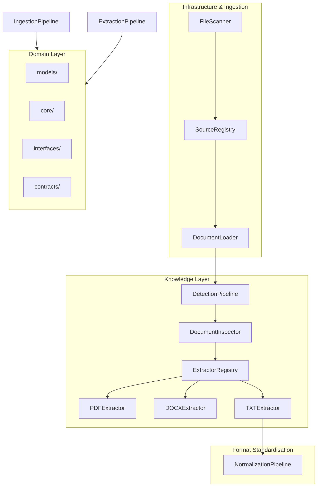

# System Architecture Blueprint - AuroraEngine

This document acts as the canonical blueprint for AuroraEngine contributors, detailing core layers, dependency flows, document lifecycles, and design constraints.

---

## 1. High-Level Blueprint

---

## 2. Ingestion Document Lifecycle & States
Every resource ingested by AuroraEngine follows a strict, one-way state transition sequence:

1. **DISCOVERED**: File found on storage media by `FileScanner`.
2. **REGISTERED**: Unique record containing checksum and metadata registered with `SourceRegistry`.
3. **LOADED**: Resource bytes read into memory by `DocumentLoader` as a `RawDocument`.
4. **EXTRACTED**: Binary content parsed into structural plain text (`ExtractedDocument`).
5. **NORMALIZED**: Text stripped of noise, normalized for model safety (`NormalizedDocument`).
6. **SEGMENTED**: Segmented into conceptually linked chunks (`StructuredDocument`).

---

## 3. Core Architectural Constraints
1. **Clean Architecture Isolation**: Domain schemas (`models/`) must never import from outer implementation layers.
2. **Immutability Principle**: Pipeline stages must produce new, frozen models instead of mutating input models in-place (Pydantic models configured with `frozen=True`).
3. **Registry Decoupling**: Downstream components cannot query the `ModuleRegistry` or `ExtractorRegistry` as a Service Locator. Inject dependency instances at construction.
4. **Abstract URIs**: Document references use URIs (e.g. `file://`, `s3://`), preventing local path hardcoding.

---

## 4. Architecture Decision Records (ADRs)
* [ADR-0001: Project Constitution Adopted](file:///d:/AuroraEngine/docs/architecture/adr/ADR-0001-project-constitution.md)
* [ADR-0002: Use of src/ Package Layout](file:///d:/AuroraEngine/docs/architecture/adr/ADR-0002-src-layout.md)
* [ADR-0003: Clean Architecture Enforcement](file:///d:/AuroraEngine/docs/architecture/adr/ADR-0003-clean-architecture.md)
* [ADR-0004: Semantic Versioning Strategy](file:///d:/AuroraEngine/docs/architecture/adr/ADR-0004-semantic-versioning.md)
* [ADR-0005: Source Registry as Single Source of Truth](file:///d:/AuroraEngine/docs/architecture/adr/ADR-0005-registry-source-of-truth.md)
* [ADR-0006: Ingestion Document Lifecycle](file:///d:/AuroraEngine/docs/architecture/adr/ADR-0006-document-lifecycle.md)
* [ADR-0007: Immutable Pipeline Stages](file:///d:/AuroraEngine/docs/architecture/adr/ADR-0007-immutable-pipeline.md)
* [ADR-0008: Document Extractor Plugin Architecture](file:///d:/AuroraEngine/docs/architecture/adr/ADR-0008-extractor-plugins.md)
* [ADR-0009: Document Normalization Subsystem](file:///d:/AuroraEngine/docs/architecture/adr/ADR-0009-normalization-subsystem.md)

