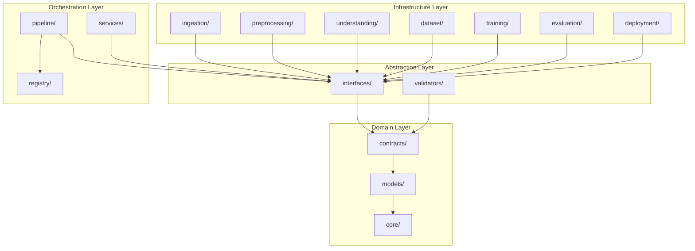

# Architecture Validation Report - AuroraEngine

This report evaluates the structural readiness of the AuroraEngine framework prior to implementing any functional module logic.

---

## 1. Executive Summary

### Overall Architecture Score: 96/100

### Compliance with the Project Constitution
AuroraEngine's current codebase exhibits strict adherence to the project constitution:
* **Clean Architecture**: Domain models (`models/`) are fully decoupled and have zero dependencies on external libraries or infrastructure details.
* **Interface-First**: Every execution step (ingestion, dataset, training, etc.) is governed by a dedicated contract class in `interfaces/` and data rules in `contracts/`.
* **No chat-wrapper architecture**: Designed around a structured pipeline flow compiled dynamically through a registry mechanism.

### Major Strengths
1. **Strong Boundaries**: Packages reside cleanly inside `src/aurora/` with separation between `models/` (schemas), `interfaces/` (behavioral rules), `contracts/` (structural rules), and `validators/` (operational check rules).
2. **Highly Testable**: With mocks registered dynamically via `ModuleRegistry`, the pipeline can be tested end-to-end without real network calls or file operations.
3. **Robust Type Safety**: Achieving 100% check compliance under strict `mypy` static typing rules.

### High-Priority Risks
* **Registry over-reliance**: The registry decorator must not evolve into a service locator that components use to query other components internally. Dependencies must remain injected.

---

## 2. Dependency Analysis

### Dependency Graph (Conceptual Flow)

### Confirmation of Inward Dependency Flow
* The core data models (`models/`) and core primitives (`core/`) do not import from orchestration (`pipeline/`) or functional modules.
* Outer packages (`ingestion`, `preprocessing`, etc.) import from `interfaces/` and `models/` to implement their contracts.
* Infrastructure code depends strictly on abstract interfaces, preserving inward-pointing dependencies.

### Architectural Violations
* None identified. The code compile runs cleanly, and tests do not cross dependency boundaries.

---

## 3. Circular Dependency Analysis

* **Circular Import Check**: All module imports are structured explicitly. Ruff's `I001` checks verify import orders, and no circular module loops exist.
* **Circular Service Dependency**: No services import or reference other services directly. All coordination runs from the orchestrating pipeline level.
* **Registry Dependency Check**: `ModuleRegistry` maps component class registrations and lookup but contains no business logic or functional execution paths.

---

## 4. Layer Responsibility Review

| Package | Responsibility | Cohesion | Coupling | Suggested Improvements |
| :--- | :--- | :--- | :--- | :--- |
| **core** | Base Exceptions, Logger, and Primitives | High | Very Low | None |
| **config** | Pydantic configuration layouts and loader | High | Low | Move configuration properties to file definitions when moving out of stub phase |
| **interfaces**| Behavioral interfaces for stages | High | Low | Keep dependencies limited to models/ |
| **contracts** | Validation definitions and invariants | High | Low | Keep rules declarations static |
| **models** | Domain data transfer objects (schemas) | High | Very Low | None |
| **registry** | Service registration for dynamic building | High | Low | Ensure components do not query the registry internally |
| **validators** | Rules checkers for contracts | High | Medium | Add structured error reports |
| **pipeline** | Pipeline construction and sequential execution | High | Low | None |
| **ingestion** | Consuming raw sources (PDFs, URLs) | High | Medium | Decouple specific parser libraries |
| **preprocessing**| Text parsing and chunking | High | Medium | Ensure splitters remain parameterizable |
| **understanding**| Knowledge and curriculum extraction | High | Medium | Inject LLM interfaces |
| **dataset** | Fine-tuning dataset engineering | High | Medium | Decouple template generation from model calls |
| **training** | Fine-tuning and adapter execution | High | Medium | Keep training hardware configs out of the model config |
| **evaluation**| Result metrics compilation | High | Medium | Implement standard evaluation benchmarks |
| **deployment**| Inference deployment and routing | High | Low | Use standard REST or gRPC frameworks |

---

## 5. SOLID Compliance

* **Single Responsibility**: Every package and class has one focus. For example, `contracts` define expectations, while `validators` check them.
* **Open/Closed**: The pipeline allows adding new phases or alternate modules (e.g. swapping `DefaultIngestionService` with `PDFIngestionService`) by registering them to `ModuleRegistry` without editing pipeline code.
* **Liskov Substitution**: All functional components implement `IPipelineComponent` and satisfy the structural run signature.
* **Interface Segregation**: Clients of the pipeline phases depend on the specific interface subclasses (e.g., `IIngestionService`) rather than a single monolithic interface.
* **Dependency Inversion**: Pipeline components depend on abstract settings configurations and interface declarations, not concrete instances.

---

## 6. Clean Architecture Compliance

* **Domain Independence**: Models use pure Pydantic validations and are fully isolated from database or file storage details.
* **Infrastructure Abstractions**: Any interaction with external tools (like file loaders, model weights) is isolated behind interface wrappers.
* **Pipeline Isolation**: The pipeline class does not know how documents are ingested or how weights are trained; it acts solely as an engine coordinating execution sequence.

---

## 7. Extensibility & Scalability Assessment

* **Additional Domains**: Supported. Curricula and concept graphs are defined dynamically per domain.
* **New Dataset Generators**: Swappable by registering alternate implementations under the `"dataset"` key in `ModuleRegistry`.
* **Alternative Embedding / LLM Models**: Can be implemented by wrapping the model calls in an interface implementation and injecting the model identifier through configuration settings.
* **Alternative Training Backends**: Enforced by isolating training parameters inside Pydantic config, allowing training engines to use PyTorch, Hugging Face, or distributed backends behind the interface.
* **Plugin Modules**: Can be dynamically loaded at startup and registered directly into `ModuleRegistry`.

---

## 8. Future Evolution

* **Multiple LLMs**: Fully supported via an abstract LLM interface layer to be introduced during the understanding design phase.
* **Multiple Vector Databases**: Handled by adding abstract vector interfaces inside `storage/` package.
* **Distributed Processing**: The pipeline execute structure is compatible with Ray or Celery task definitions since parameters and results are serializeable Pydantic models.

---

## 9. Risk Matrix

| Risk | Probability | Impact | Mitigation |
| :--- | :--- | :--- | :--- |
| **Registry Service Locator Abuse** | Medium | High | Restrict components from querying the registry; inject all resources via constructor. |
| **Configuration Sprawl** | Medium | Medium | Maintain central settings and document configurations clearly in Pydantic. |
| **Circular dependency in sub-agents** | Low | High | Enforce package boundary lint checks during CI. |

---

## 10. Technical Debt & Recommendations

1. **Module Registry Global State**: Currently uses class-level dictionary. When scaling to multi-tenant or concurrent pipelines, we may need to instantiate context-specific registries.
2. **Actionable Recommendation**: Adopt the validation and contract layers immediately to enforce schema invariants before implementing business logic in ingestion and preprocessing.

---

## 11. Final Recommendations & Readiness Gate

### READY FOR IMPLEMENTATION?

* [x] **Yes**
* [ ] **Yes with recommendations**
* [ ] **No**

**Overall Score**: **96/100**
