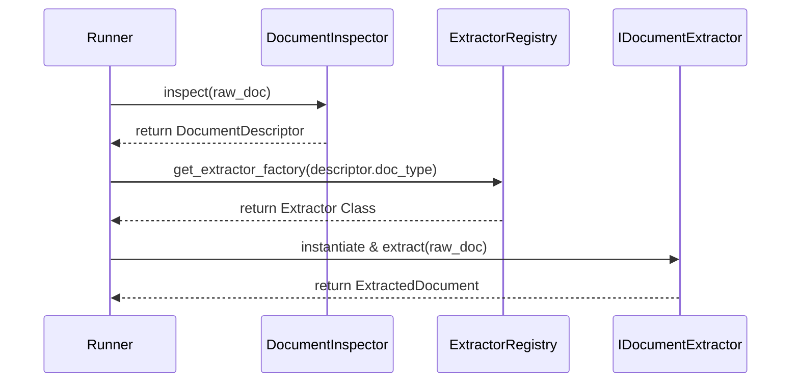

# Document Extraction Subsystem Design Document

## Problem Definition
How do we parse diverse document formats (PDF, DOCX, TXT, MD, HTML) into rich structured data (`ExtractedDocument`) in an extensible, testable, and type-safe manner?

## Responsibilities
* **DocumentInspector**: Classifies raw document bytes using magic byte signatures (and scans ZIP entry names for DOCX/Office file types).
* **ExtractorRegistry**: Registers extractor factories and maps them to `DocumentType`s.
* **IDocumentExtractor**: Defines contract containing `extract(doc: RawDocument)` and capacity metadata.

## Sequence Diagram

## Error Model
* `ExtractionError`: Base class.
* `UnsupportedExtractionError`: Raised when no extractor is registered for a type.
* `ExtractionFailedError`: Raised if extraction crashes.
* `CorruptedDocumentError`: Raised if document magic bytes match but payload parser fails (corrupt file).
* `DecoderError`: Raised on text decoding errors (e.g. invalid UTF-8).
