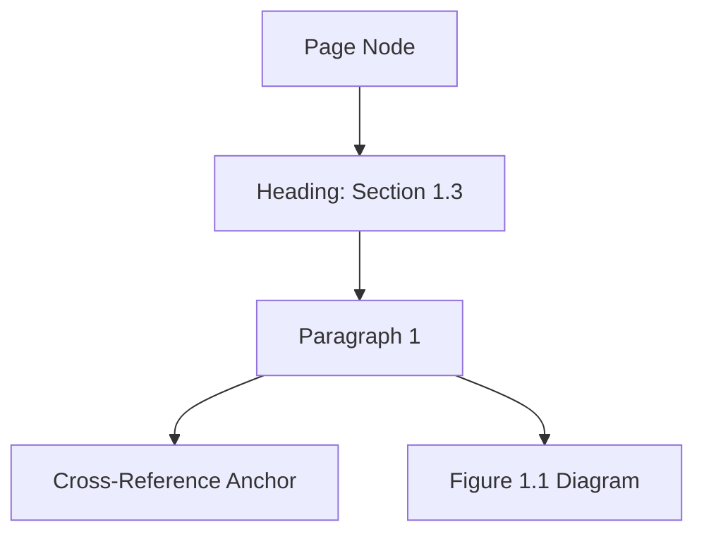

# Design Proposal: Aurora v2 Document Intelligence Pipeline

This document defines the architectural upgrade paths for **Aurora v2 Document Intelligence**, enriching Phase 1 (L1/L2) loaders and segmenters to parse high-fidelity layout graphs, math expressions, structured tables, and cross-reference anchors.

---

## 1. Upgraded Document Models

### Structured Tables (O(1) Cell Querying)
Rather than raw multiline text blocks, tables are represented as structured grids:
```python
class TableCell(BaseModel):
    row_index: int
    column_index: int
    row_span: int = 1
    col_span: int = 1
    content: str
    is_header: bool = False
    bbox: Tuple[float, float, float, float]  # Coordinates: x1, y1, x2, y2

class StructuredTable(BaseModel):
    table_id: UUID
    caption: Optional[str] = None
    cells: List[TableCell]
    columns_count: int
    rows_count: int
```

### Visual and Mathematical Recognition
- **Mathematical Equations**: Captured natively using LaTeX formatting rules:
  ```python
  class MathExpression(BaseModel):
      expression_id: UUID
      raw_latex: str  # e.g. "10^{12}" or "A \rightarrow B"
      is_display_mode: bool = False  # Display vs inline block
  ```
- **Figure Graph Mappings**: Diagrams are decomposed into semantic graph nodes:
  ```python
  class FigureNode(BaseModel):
      node_id: str
      label: str
      bbox: Tuple[float, float, float, float]

  class FigureEdge(BaseModel):
      source_id: str
      target_id: str
      relationship: str

  class FigureUnderstanding(BaseModel):
      figure_id: UUID
      caption: str
      nodes: List[FigureNode]
      edges: List[FigureEdge]
  ```

---

## 2. Layout Graph and Cross-Reference Anchors

Instead of sequential array index processing, the document page layout is captured as an adjacency graph:



### Cross-Reference Resolution
Tracks relationships between document parts:
```python
class CrossReference(BaseModel):
    reference_id: UUID
    source_segment_id: str
    target_segment_id: str
    reference_type: str  # e.g., "mentions_figure", "see_section"
```

---

## 3. Implementation Workflow

1. **Layout Detection Step**: Runs object-detection (like LayoutLM) to localize bounding boxes for text blocks, tables, figures, and formulas.
2. **Reading Order Engine**: Sequences columns using reading flow confidence levels to prevent interweaving.
3. **Table & Math Extraction**: Decodes cells and compiles equations to LaTeX.
4. **Link Resolution**: Connects citation anchors to target segments.
5. **Knowledge Integration**: Passes Layout Graph and Cross-References directly to the L2 Knowledge Graph Builder.
