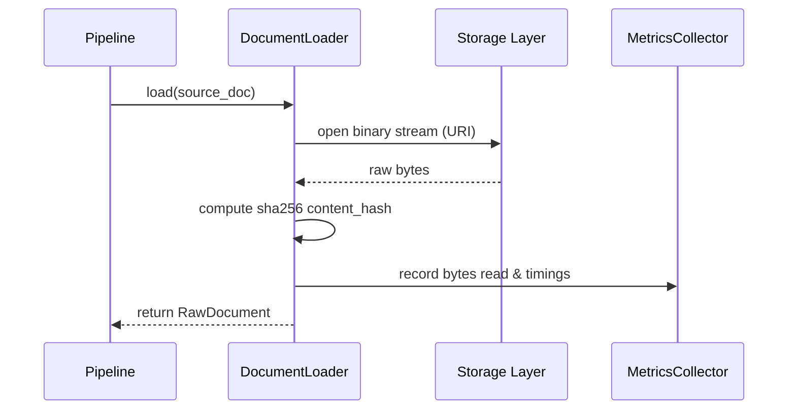

# Document Loader Design Document

## Problem Definition
How do we load registered documents into memory as immutable raw payloads without guessing file content types or performing parsing transformations?

## Responsibilities
* **DocumentLoader**: Resolves source document URIs, reads binary content stream, calculates the content hash, and maps properties to `RawDocument` while recording load metrics.

## Public Interfaces
* See [IDocumentLoader](file:///d:/AuroraEngine/src/aurora/interfaces/loader.py).

## Sequence Diagram

## Error Model
* `DocumentLoadError`: Base class.
* `UnsupportedDocumentError`: Raised if document format is unsupported (e.g. unknown or unparseable extensions).
* `UnreadableDocumentError`: Raised if files are corrupted or fail to read.
* `PermissionDeniedError`: Raised if OS prevents file stream reads.
