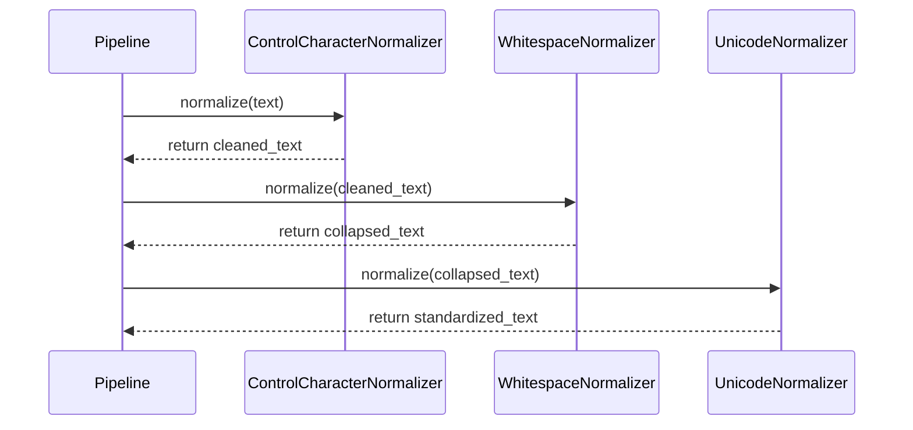

# Document Normalization Subsystem Design

## Problem Definition
How do we strip control characters, standardize whitespace, and unify Unicode text representations of extracted documents while preserving structures (tables, images, links) in an extensible way?

## Responsibilities
* **INormalizationStep**: Contract for individual cleaning rules.
* **NormalizationContext**: Configures pipeline execution (e.g. collapse whitespace, preserve Markdown) and collects metrics.
* **NormalizationPipeline**: Combines steps and converts `ExtractedDocument` to the `NORMALIZED` state `NormalizedDocument`.

## Sequence Flow

