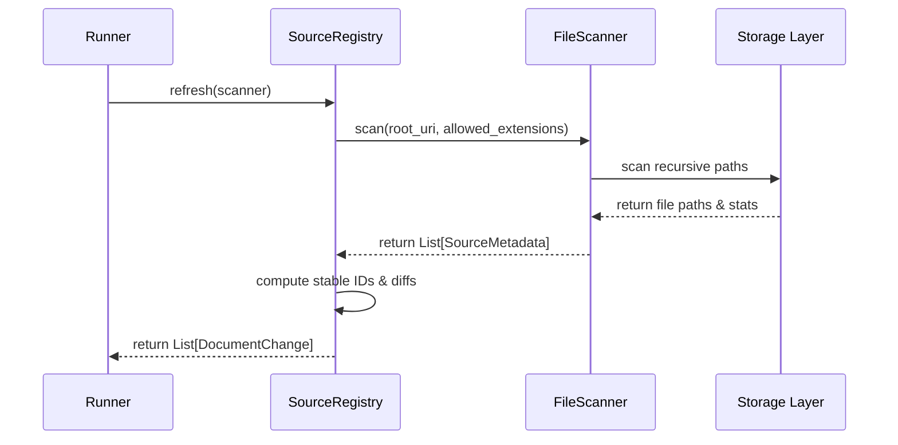

# Source Registry and File Scanner Design Document

## Problem Definition
How does the system discover educational resource files, track change histories, map them to subjects, and present a stable API to downstream modules without reading file contents?

## Responsibilities
* **FileScanner**: Traverses local/remote storage paths, filters by supported formats, records raw metadata (size, mod-time, checksum).
* **SourceRegistry**: Maps subjects, acts as the canonical storage, tracks checksum changes, assigns stable IDs, and detects mutations (`DocumentChange`).

## Public Interfaces
* `IFileScanner`: `scan(uri: str, extensions: Set[str]) -> List[SourceMetadata]`
* `ISourceRegistry`: `refresh(scanner: IFileScanner) -> List[DocumentChange]`

## Sequence Diagram

## State Transitions (DocumentChange)
* **NEW**: Asset path not found in registry -> created as active.
* **UNCHANGED**: Asset matches stored checksum -> last verified timestamp updated.
* **MODIFIED**: Asset checksum changed -> version incremented.
* **REMOVED**: Registered asset path no longer found in scan -> status set to REMOVED.

## Error Model
* `DuplicateSourceError`: Raised when attempting to register two identical documents at different paths under the same namespace context.
* `SourceNotFoundError`: Raised when querying a non-existent document ID.
* `InvalidSourceError`: Raised when scanner encounters unreadable files or invalid URIs.
